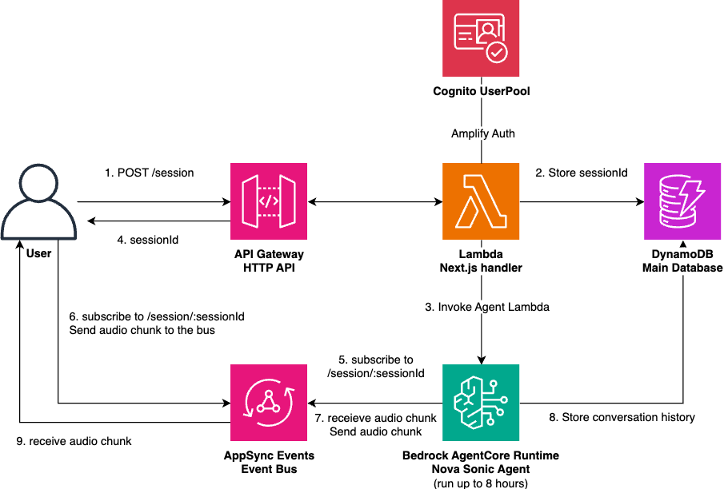
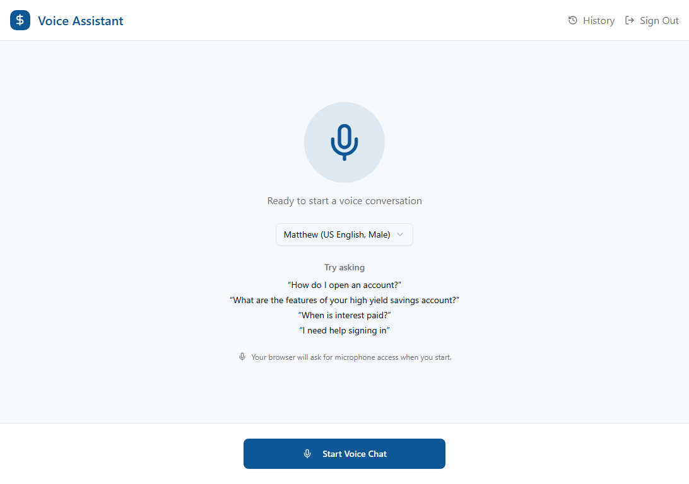

# DemoBank Voice Assistant

A speech-to-speech voice assistant for the fictional DemoBank, built on Amazon Nova 2 Sonic and serverless AWS services. It answers spoken questions about DemoBank high yield savings accounts and declines everything else.

The project started from an AWS sample for deploying a Nova Sonic application.



## Key Features

- Real-time voice conversation in the browser, with serverless communication between client and agent over AppSync Events
- Live status (listening, thinking, speaking, muted) with a waveform, and a transcript with timestamps
- Conversation history, with copy and download of each transcript
- The assistant's instructions and knowledge live in one server-side system prompt
- Sign-in through Amazon Cognito; users are created by an administrator
- ToolUse and MCP (Model Context Protocol) support in the agent
- Each conversation is limited to 3 minutes
- UI built with Next.js + shadcn, usable on phones and computers

## Deployment Instructions

### 1. Prerequisites

First, prepare an environment capable of running AWS CDK. This environment must meet the following conditions:

* Required software installed:
  * [Node.js](https://nodejs.org/en/download/)
    * v20 or higher recommended
    * Check with `node -v` command
  * [AWS CLI v2](https://docs.aws.amazon.com/cli/latest/userguide/getting-started-install.html)
    * Check with `aws --version` command
  * Docker
    * Check with `docker --version` command
* AWS CLI configured with appropriate AWS IAM permissions (Administrator equivalent required)
  * Set up IAM role or enter IAM user information with `aws configure` command
* Internet connection with ability to communicate with AWS APIs
  * May not work properly in closed network environments

Any environment that meets the above requirements can be used, including local terminals or EC2 instances. Once you've confirmed these conditions, proceed to the next step.

### 2. Deployment Parameter Configuration

You can configure deployment parameters by editing [cdk.ts](cdk/bin/cdk.ts).

Configurable parameters include:

* Deployment region (default: inherits IAM session)
* Nova Sonic model region (default: us-east-1)
* Cognito self sign-up (disabled in this repository; the stack default is enabled)
* Email domains allowed to sign up to Cognito (default: all allowed)

See the file for details.

### 3. Enable Bedrock Foundation Models
From the [Amazon Bedrock Management Console](https://console.aws.amazon.com/bedrock/home#/modelaccess) in the `bedrockRegion` you specified in the step#2 (us-east-1 by default), enable the Nova 2 Sonic model.

### 4. CDK Bootstrap

Next, perform [CDK Bootstrap](https://docs.aws.amazon.com/cdk/v2/guide/bootstrapping.html).

Run the following commands:

```sh
cd cdk
# Install Node dependencies
npm ci
# Initialize CDK for use in your AWS environment
npx cdk bootstrap
```

`npm ci` installs Node dependencies. This is only required for the first run.

`cdk bootstrap` performs initial setup to enable CDK usage in your environment.
This is required when using CDK for the first time in a specific AWS account and region. It's not needed for subsequent runs.

If you see `✅ Environment aws://xxxx/us-east-1 bootstrapped`, the bootstrap was successful. Proceed to the next step.

## 5. CDK Deploy

With CDK deployment preparation complete, run the following command to deploy all necessary CDK stacks:

```sh
cd cdk
npx cdk deploy
```

Deployment typically takes about 5 minutes. The first deployment from a machine that is not ARM-based takes longer, because the agent image is built for ARM64 under emulation.

Upon successful deployment, stack output will be displayed as follows:

```
 ✅  ServerlessNovaSonicChatStack

✨  Deployment time: 164.16s

Outputs:
ServerlessNovaSonicChatStack.AgentAgentCoreRuntimeArn43CC4D6A = arn:aws:bedrock-agentcore:us-east-1:123456789012:runtime/...
...
ServerlessNovaSonicChatStack.ServiceApiEndpointC0AA9658 = https://1234567.execute-api.us-east-1.amazonaws.com
```

Open the `ServiceApiEndpoint*` URL in your browser. If a login screen appears, deployment was successful.

This completes CDK deployment. Next, we'll explain how to use the application.

## Usage

### Login
When you open the URL in a browser, a login button will be displayed. Self sign-up is disabled, so an administrator first creates the user in the stack's Cognito user pool (Amazon Cognito console > User pools > Create user). Then log in with that user.

> [!IMPORTANT]
> If you enable self sign-up (`selfSignUpEnabled` in [cdk.ts](cdk/bin/cdk.ts)), anyone who knows the URL can register as a user. In that case it's recommended to restrict sign-up eligible email domains in [2. Deployment Parameter Configuration](#2-deployment-parameter-configuration).

After logging in, the following screen will be displayed:



### Voice Conversation

Choose a voice, then press the `Start Voice Chat` button and allow microphone access when the browser asks. Once the status shows "Listening", ask a question such as "How do I open an account?".

* Voice: Two US English Nova Sonic [voices](https://docs.aws.amazon.com/nova/latest/userguide/available-voices.html) are selectable. The list is in [voices.ts](app/src/lib/voices.ts).
* System prompt: The assistant's behavior and everything it knows about DemoBank are defined in [systemPrompt.ts](app/src/lib/systemPrompt.ts). It is applied on the server and cannot be changed from the browser.
* You can interrupt the assistant by speaking, and mute the microphone with the mute button or the `M` key.

Press the `Stop Voice Chat` button to end the conversation. The conversation also ends automatically after 3 minutes. The transcript stays on screen afterwards and can be copied or downloaded.

### Viewing Conversation Logs

Open `History` from the header to view past conversations.

### MCP Support

This agent now supports MCP (Model Context Protocol), enabling integration with various external services and tools. This allows the agent to:

- Access databases, APIs, and other external data sources
- Extend capabilities through community-developed MCP servers

**Important Notes:**
- No MCP servers are configured by default. The configuration is set on the server, in [actions.ts](app/src/app/%28root%29/actions.ts), and is never accepted from the browser, because the agent runs the commands it names
- Supports MCP servers that can be executed via `uvx` or `npx`
- Tools are executed synchronously, so long-running tools may not be suitable

An example mcp config is below:

```json
{
  "mcpServers": {
    "fetch": {
      "command": "uvx",
      "args": ["mcp-server-fetch"]
    },
    "DeepWiki": {
      "url": "https://mcp.deepwiki.com/sse",
      "enabled": false
    }
  }
}
```

### Other Notes

* The app works on mobile devices as well as computers (responsive design).
* For Nova Sonic details, see [agent/README.md](app/src/agent/README.md)

## Development

Run these from `app/` after `npm ci`:

```sh
npm test            # unit tests
npm run lint
npx tsc --noEmit
```

`npm run build` needs the placeholder auth variables that the [Dockerfile](app/Dockerfile) sets (`USER_POOL_CLIENT_ID`, `USER_POOL_ID`, `AMPLIFY_APP_ORIGIN`, `COGNITO_DOMAIN`). To run the frontend locally against deployed resources, see [app/README.md](app/README.md).

From `cdk/`, `npm test` runs the stack snapshot test and `npx cdk diff` shows what a deployment would change.

## Cost

The table below is the original sample's estimate for a **10 minutes/session** conversation. This app limits a conversation to 3 minutes, so a session costs proportionally less. The cost per session (USD) is as follows. Note that the dimensions such as token counts per session are examples and will vary depending on your actual use case.

| AWS service        | Dimensions                               | Cost [USD/session] |
|--------------------|------------------------------------------|------------------|
| Bedrock Nova Sonic | Input token (speech): 300 tokens/minute  | **0.0102**       |
| Bedrock Nova Sonic | Output token (speech): 200 tokens/minute | **0.0272**       |
| Bedrock Nova Sonic | Input token (text): 4000 tokens/session  | 0.00024          |
| Bedrock Nova Sonic | Output token (text): 1000 tokens/session | 0.00024          |
| AppSync Events     | Requests: 250 events/session/minute      | **0.0025**       |
| AppSync Events     | Connection: 10 minutes/session           | 0.00000008       |
| Lambda             | Duration: 512MB, 10 minutes/session      | **0.004**        |
| Lambda             | Requests: 2 invocations/session          | 0.00000004       |
| API Gateway        | Requests: 20 requests/session            | 0.00001          |
| DynamoDB           | Read: 10 RRU/session                     | 0.00000125       |
| DynamoDB           | Write: 50 WRU/session                    | 0.00003125       |
| DynamoDB           | Storage: 30 kB/session (monthly)         | 0.0000075        |
| TOTAL              |                                          | 0.044            |

Looking only at real-time communication costs (Lambda + AppSync Events), it comes to 0.00045 USD/minute. This is about 1/9th the cost of [LiveKit Cloud](https://livekit.io/pricing), showing this is a scalable yet cost-efficient architecture.

**Note**: Pricing information is based on August 2025 data. Please check the official AWS pricing pages for the most current pricing information.

### Resource Cleanup

After completing verification, it's recommended to delete unnecessary resources to prevent additional charges.
To delete resources, run the following command:

```sh
cd cdk
npx cdk destroy --all
```

## License

This library is licensed under the MIT-0 License. See the LICENSE file.

## Acknowledgement

The code is heavily inspired and copied from [Generative AI Use Cases (GenU)](https://github.com/aws-samples/generative-ai-use-cases).
